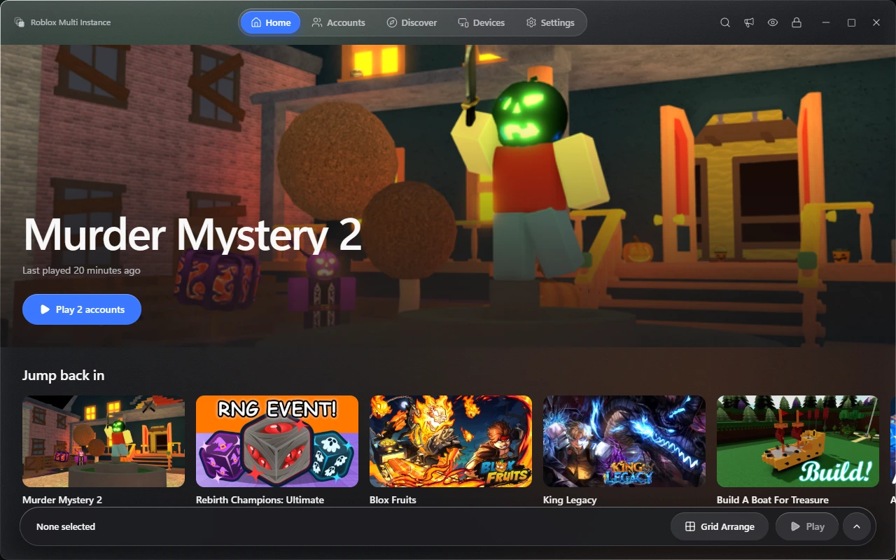
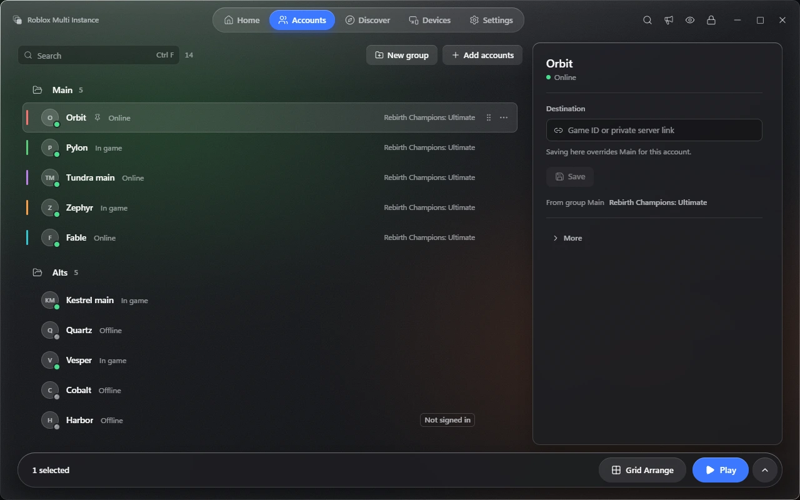
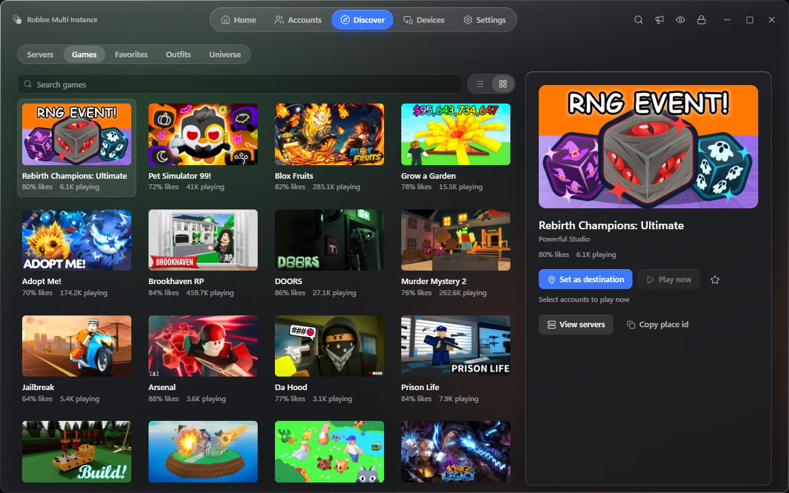
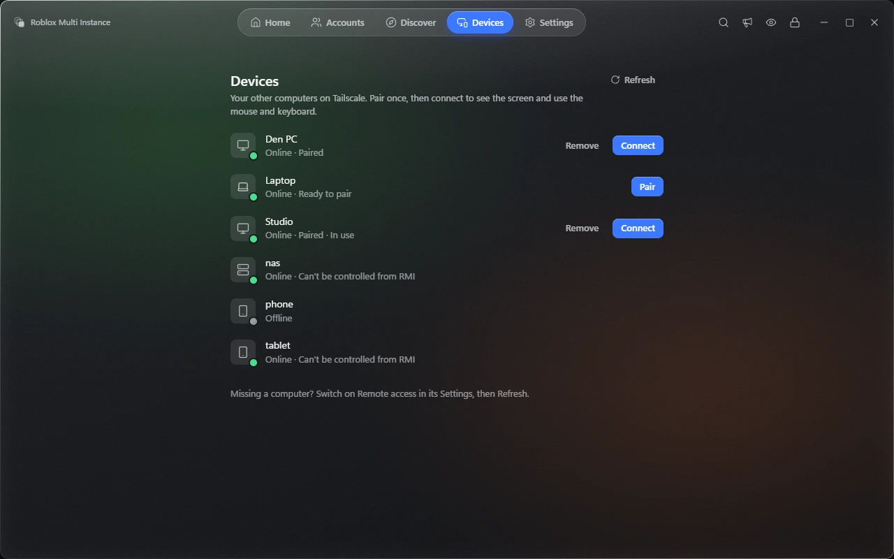
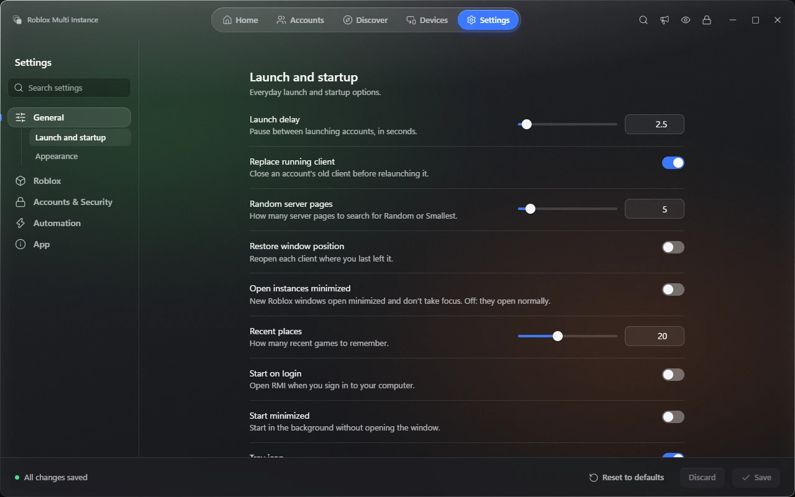
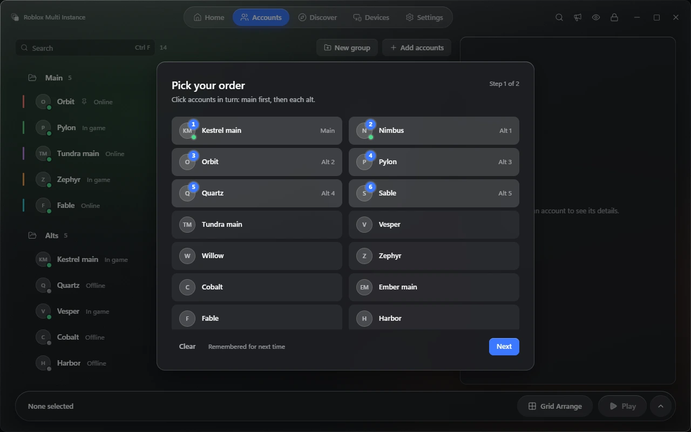
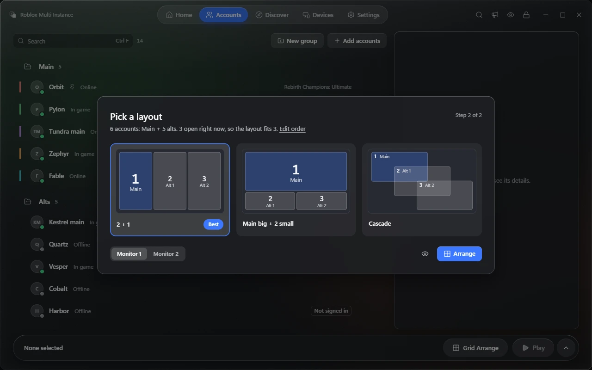

# Roblox Multi Instance

RMI is a desktop app for running a bunch of your own Roblox accounts on one computer. It keeps them in an encrypted vault, launches several into the same game at once, and tiles the windows so you can see all of them.

Windows 10 and 11 (x64) is the main platform. macOS and Linux builds exist with limits, listed under [Download](#download). Unofficial and not affiliated with Roblox. A Roblox update can break multi-instance at any time, and it stays broken until I patch it.

<p align="center"><br><sub>Home. Press Play to launch the accounts you used last.</sub></p>

## Why I made it

I've been playing Roblox for many years now, and there have been some good account managers, but none of them really stuck with me. So I made my own. This was more of a personal project on my end, and it's open source: you're free to modify it however you want, and pull requests are welcome if you want to make it better for everyone.

## Download

All downloads are on [GitHub Releases][latest], under Assets.

### Windows

Grab the `x64-setup.exe` installer (for example `Roblox.Multi.Instance_1.0.4_x64-setup.exe`) from the [latest release][latest] and run it. It installs for your user only and doesn't ask for admin. An `.msi` is there too; it may install somewhere else, so with it use the in-app "Add RMI to Windows Security" button instead of the folder below (the button finds RMI's real folder).

Or paste this into PowerShell. It first adds RMI's folder to Windows Security's exclusions (one admin prompt, [here's why](#windows-security-says-its-a-virus)), then downloads the newest installer from the latest release and starts it. Click No on the admin prompt to skip the exclusion; the install still runs.

```powershell
Start-Process powershell -Verb RunAs -Wait -ArgumentList "-NoProfile -Command Add-MpPreference -ExclusionPath '$env:LOCALAPPDATA\Roblox Multi Instance'"; $u = ((irm https://api.github.com/repos/KingIcyCreamProjects/Roblox-Multi-Instance/releases/latest).assets | ? name -like '*x64-setup.exe')[0].browser_download_url; iwr $u -OutFile "$env:TEMP\rmi-setup.exe"; Start-Process "$env:TEMP\rmi-setup.exe"
```

The installer isn't code-signed, so SmartScreen will show "Windows protected your PC". That's because it's an unknown program, not because anything flagged it. Click More info, then Run anyway.

To update, run a newer installer (or the PowerShell line again). Your vault and settings stay.

### Windows Security says it's a virus

Defender sometimes flags RMI as `Trojan:Win32/Bearfoos.A!ml` and deletes it. The `!ml` means its machine-learning model made a guess. It didn't match any known malware. New apps without a code-signing certificate get guessed at a lot, and RMI does things that look odd out of context: it starts and closes Roblox, reads the Roblox login cookie to sign your accounts in, and holds the lock Roblox uses to stop a second copy from opening. A signing certificate costs money every year and this is a free project, so for now it isn't signed. All the code is here if you want to read it or build it yourself.

To stop it, add RMI's folder to the exclusions. Open PowerShell as admin and run:

```powershell
Add-MpPreference -ExclusionPath "$env:LOCALAPPDATA\Roblox Multi Instance"
```

Then run the installer again. The install line above already does this, and so does the "Add RMI to Windows Security" button in the app's first-run tutorial (Settings, About, Show tutorial again).

If you'd rather not add an exclusion, get it back each time instead: Windows Security, Virus & threat protection, Protection history, click the RMI entry, then Actions, Allow on device. A later update can get flagged again.

Uninstalling RMI leaves the exclusion in place. To remove it, run `Remove-MpPreference -ExclusionPath "$env:LOCALAPPDATA\Roblox Multi Instance"` as admin.

### macOS

Download the `.dmg` (universal, Apple silicon and Intel). The app is not notarized by Apple, so Gatekeeper will warn the first time. Right-click the app, choose Open, then Open again. If macOS offers no Open button (newer versions), go to System Settings, Privacy & Security, and click Open Anyway for RMI. Core features work and multi-instance is best effort. macOS is newer than Windows and less tested.

### Linux

Download the `.deb` (Debian, Ubuntu, Mint), the `.rpm` (Fedora, openSUSE) or the `.AppImage` (anything else). They are built on Ubuntu 22.04, so they run on Ubuntu 22.04, Debian 12 and Mint 21 or newer, and on current Fedora and Arch. Launching goes through [Sober](https://sober.vinegarhq.org/) (the Flatpak `org.vinegarhq.Sober`), so you need it installed. Running several accounts at once also needs `pasta` (package `passt`); RMI then gives each client its own Sober profile. Linux is the least tested platform.

## First run

1. Pick how the vault is protected: your operating system alone, or a master password on top.
2. A short tour points out the main screens. You can replay it from Settings, About, Show tutorial again.
3. Add your accounts with the Roblox sign-in window, a pasted cookie, or an import from another account manager, then put them in a group.

## What it does

- Keeps accounts in one encrypted file. Lock it with Windows itself or a master password. It auto-locks, keeps backups and can export.
- Adds accounts through a Roblox sign-in window, a pasted cookie, or an import from another account manager. Groups keep them sorted.
- Launches several accounts at once into a game or private server. Groups and accounts each get a saved destination (the account's wins) and a server choice: Any, Smallest, Random or a specific one. Clients start one after another, cancellable.
- Holds Roblox's singleton mutex so more than one client can run. Since 0.2.0 a small helper process holds it, so open clients survive RMI closing or crashing.
- Auto-reconnect, off by default. It watches the Roblox client log for disconnects (Wi-Fi drops, error 277, idle kicks) and relaunches that account into the game without touching your mouse or keyboard. Relaunches are rate limited.
- Discover: game search, a server browser with players, ping and region, favorites, recents and outfits. Anything there can become a destination.
- Per-account tools (display name, password, sessions, blocks and more), a watcher that closes stuck or hung clients, a privacy mode that blurs names, and a tray icon.
- An automation API (WebSocket plus a local web API, token required) for your own scripts. Off until you enable it. See [docs/AUTOMATION.md](docs/AUTOMATION.md).
- Also: Run here (move a running account to this computer from a paired one), launch chosen accounts when RMI starts on login, Anti-AFK, client helpers (minimize every N seconds, close after N minutes, a cap on open clients), window position restore, and a Ctrl/Cmd+K command palette.
- By default every client RMI launches is capped at 60 FPS and graphics level 1 (the lightest). Change both in Settings, or hand them back to Roblox.

## Friend remote

Friend remote lets one friend disconnect and reconnect chosen accounts from a web page, for example when a client freezes while you are away. The friend needs nothing installed, only a browser, a username and a password.

Only the accounts you allow appear, and the friend can do only Disconnect and Reconnect. Nothing else on your PC is reachable.

"Let your friend add accounts" is a separate switch and is off by default. With it on, your friend can sign their own Roblox account in on your computer with a Quick Log In code. Two limits: it does not work for accounts with 2-step verification on, and Roblox checks where a login comes from, so it only works when your friend is on the same network as your computer or close to it. From far away Roblox can block the login or sign the account out. It needs your own free Tailscale account. Settings, Friend remote walks you through installing Tailscale, signing in and turning on the link. Details are in [docs/friend-remote.md](docs/friend-remote.md). It is off until you turn it on.

## Devices (remote access)

The Devices tab lists your other computers on your own Tailscale network. Pair one once with a code shown on it, then connect to see its screen and use its mouse and keyboard, for example to check Roblox on the PC upstairs. Each computer stays off until you switch on Settings, Remote access on that computer itself, and it shows a bar with Stop while it is controlled. File transfer is its own switch and is also off until you turn it on. Details are in [docs/remote-access.md](docs/remote-access.md).

## Updates

RMI checks GitHub for new versions. One it finds when it opens is installed right away, and RMI restarts by itself; one found while RMI is running waits for the next time you open it (or install it from Settings). To be asked first, clear "Install updates automatically" in Settings. Updates are signed, and RMI refuses one that doesn't verify against the public key built into the app. To turn the check off, clear "Check for updates automatically" in Settings. Your vault and settings stay across updates. Updates work on Windows, macOS and Linux. On Linux the AppImage replaces itself, and a `.deb` or `.rpm` install asks for your admin password to update.

## Using it

1. On first run, pick how the vault is protected.
2. Add your accounts and put them in a group.
3. Set the group's destination in the side panel. For a one-off trip somewhere else, use Play once, which leaves saved destinations alone.
4. Select the accounts and press Play.
5. Once the windows are up, open Grid Arrange.

Grid Arrange is two steps. You put the accounts in order once (main, alt 1, alt 2...), then it offers the layouts that suit that many windows: 3 x 2 for six, one big main with small ones beside it, a cascade, and so on. Pick the monitor. Identify flashes a number on each real Roblox window so you can check which is which.

<table>
<tr><td></td><td></td></tr>
<tr><td></td><td></td></tr>
<tr><td></td><td></td></tr>
</table>

## Things to know

- Windows is the best supported platform. macOS and Linux are newer and less tested (see [Download](#download) and the table below).
- Multi-instance and auto-reconnect depend on how the Roblox client behaves today (its mutex and its log format). Roblox can change either.
- Your data lives in `%APPDATA%\Roblox Multi Instance` on Windows, `~/Library/Application Support/Roblox Multi Instance` on macOS and `~/.local/share/Roblox Multi Instance` on Linux, logs and backups included. The sign-in windows keep their browser profiles in the app cache folder, `%LOCALAPPDATA%\com.kingicycreamprojects.robloxmultiinstance` on Windows. Start RMI with `--portable` to keep the data and the sign-in profiles in `data\` next to the exe instead. The main window's position and its own web cache (theme and similar) still stay in the usual app folders.
- Server regions come from ip-api.com over plain HTTP, because their free tier has no HTTPS. It's off on new installs; turn it on in Settings if you want regions.

## Platform support

| Feature | Windows | macOS | Linux |
| --- | --- | --- | --- |
| Vault, accounts, groups, import | Yes | Yes | Yes |
| Launch, saved destinations, Play once | Yes | Yes | Yes, through Sober |
| Several clients at once | Yes | Best effort | Yes, needs `passt` |
| Watcher and auto-reconnect | Yes | Yes | Yes |
| Friend remote | Yes | Yes | Yes |
| Devices: control another computer | Yes | Yes | Yes |
| Devices: be controlled | Yes | Yes | Not yet |
| Devices: sound | Yes | Not yet | Not yet |
| Grid Arrange and window placement | Yes | Yes, needs Accessibility permission | Not yet |
| Cookie lock | Yes | Not yet | Not yet |

"Not yet" rows are open for pull requests.

## Terms of Use

Can this get an account banned? It can. Running several accounts and automating clients may break Roblox's Terms of Use, and automation is the part most likely to get an account actioned. Use it with accounts you own and can afford to lose.

## Security model

The session cookie is the sensitive part, since whoever has it is that account. RMI treats cookies, saved passwords and the automation token as secrets.

- One vault file, `vault.rmiv`, encrypted with XChaCha20-Poly1305 under a random 32-byte key.
- In OS mode that key is wrapped with DPAPI on Windows, or a device key held in the OS keyring (Keychain, Secret Service) on macOS and Linux. If the keyring refuses the device key, RMI saves it as a `device.key` file (owner-only permissions) in the data folder instead, and then only those file permissions protect an OS-mode vault. In password mode it comes from Argon2id (256 MiB, 3 passes) and is then wrapped the same way, so a copied vault is useless on another machine. `--portable` only moves the data folder: a vault in it stays tied to the computer that made it. To carry accounts to another computer, use an exported portable vault.
- Writes are atomic with rolling backups. Locking wipes the key from memory, on idle and, by default, on sleep or Windows lock.
- Cookies only reach the UI through an explicit copy or reveal, and both ask you to re-authenticate. Logs are redacted (cookies, tokens, your home folder), but account names can appear in them. No telemetry.
- Outbound traffic goes to Roblox, the sign-in captcha (`arkoselabs.com`, `funcaptcha.com`), GitHub (updates), ip-api.com and, for Devices, your own computers on your Tailscale network. Nothing else.
- The automation servers bind to `127.0.0.1` unless you turn on LAN access, and always need the token.
- The friend remote server binds to `127.0.0.1` only. Tailscale Funnel is what exposes it, only if you turn it on. Without logging in, only the login page loads. Logins are limited to 10 failures per address per minute, and the friend password and token are stored encrypted with DPAPI (Windows) or a device key held in the OS keyring (macOS, Linux; a `device.key` file in the data folder if the keyring refuses it). "New password" signs the friend out everywhere.
- Remote access listens only on this computer's Tailscale address (100.64.0.0/10), never on all interfaces and never through Funnel or the friend server. It is off by default and only the local Settings page can switch it on. A paired computer holds a random token; this computer keeps only its SHA-256. One session at a time, every session is logged, and closing the "being controlled" bar ends it.

## Build from source

Rust 1.99.1, the version CI pins (MSVC toolchain on Windows; a newer one can show extra Clippy warnings), Node 22+, pnpm through corepack (the Tauri dev and build hooks call `npm run`, which comes with Node). On Linux you also need the Tauri system packages (WebKitGTK 4.1 and friends, as in `.github/workflows/release.yml`).

```bash
corepack enable
corepack pnpm i
corepack pnpm tauri dev       # dev build
corepack pnpm build:local     # installers, no updater signing
```

A plain `tauri build` also signs updater artifacts and fails with "A public key has been found, but no private key" unless `TAURI_SIGNING_PRIVATE_KEY` and `TAURI_SIGNING_PRIVATE_KEY_PASSWORD` are set.

Checks: `pnpm lint`, `pnpm typecheck`, `pnpm test`, and in `src-tauri/` `cargo fmt --check`, `cargo clippy --all-targets -- -D warnings`, `cargo test`. `pnpm e2e` (Windows) drives a debug build through `tauri-driver` in a throwaway data folder (debug-only `RMI_DATA_DIR`), so your real vault is safe. That instance keeps its sign-in profiles in the same folder, never takes the Roblox mutex holder or cookie lock of an installed RMI, and skips the login item, updater and window-state plugin.

## Publishing

Pushing a `v` tag runs `.github/workflows/release.yml`, which builds the bundles, makes a draft release and uploads `latest.json` for the updater. Review the draft, then publish it. You can also start it from the Actions tab.

```bash
git tag v1.0.4
git push origin v1.0.4
```

The tag has to match `version` in `src-tauri/tauri.conf.json` (`0.2.1-rc.1` for `v0.2.1-rc.1`), and `src-tauri/Cargo.toml` and `package.json` must carry the same version, or the run stops.

The updater public key is in `tauri.conf.json`; the private key and its password are the repo secrets `TAURI_SIGNING_PRIVATE_KEY` and `TAURI_SIGNING_PRIVATE_KEY_PASSWORD`. Never commit them. Lose the key and existing installs can't verify updates. To rotate, run `corepack pnpm tauri signer generate -w <path outside the repo>/rmi.key` and paste the new `.pub` contents into `plugins.updater.pubkey`.

## Contributing

Pull requests are welcome, big or small. Bug fixes, new features, UI tweaks, docs, all of it. Fork the repo, make a branch off `main`, and open a PR; I'll review it and merge what fits. If you're planning something big, open an issue first so we can talk it through. [CONTRIBUTING.md](CONTRIBUTING.md) has the setup and the checks to run before you push.

Found a bug? Open an issue with what you did, what happened, your OS, and the log from the `logs` folder in your data folder (see [Things to know](#things-to-know) for where that is). Cookies and tokens are redacted, but account names can appear, so give it a look before posting.

## License

MIT, see [LICENSE](LICENSE). RMI takes a lot of ideas from community account managers, ic3w0lf22's Roblox Account Manager most of all, and can import its `AccountData.json`.

[latest]: https://github.com/KingIcyCreamProjects/Roblox-Multi-Instance/releases/latest
